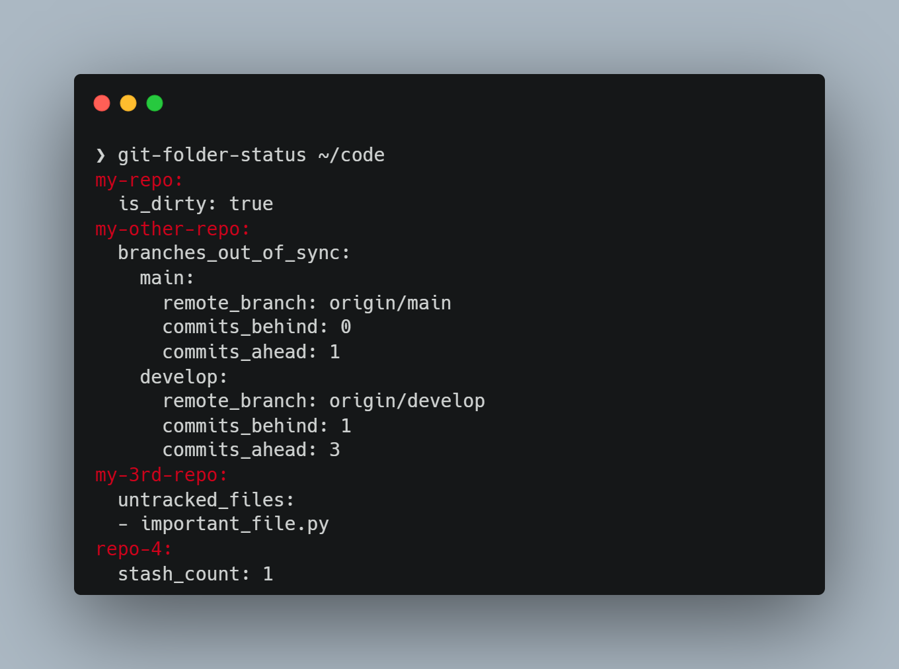

# git-folder-status

[![Tests][tests-badge]][tests-link]
[![uv][uv-badge]][uv-link]
[![Ruff][ruff-badge]][ruff-link]
[![Black][black-badge]][black-link]
[![codecov][codecov-badge]][codecov-link]
\
[![Made Using tsvikas/python-template][template-badge]][template-link]
[![GitHub Discussion][github-discussions-badge]][github-discussions-link]
[![PRs Welcome][prs-welcome-badge]][prs-welcome-link]

## Overview

Scans a directory tree and reports Git repositories that aren't fully synced
with their remote.

A day-to-day tool for when you work across multiple projects and want to keep
everything pushed and backed up. One command instead of running `git status`
in each repo.



### Why not just `git status`?

`git status` only shows uncommitted changes in the current repo. This tool
runs across all repos in a directory tree and catches things `git status`
misses:

- Stash entries
- Detached HEAD
- Branches without a remote
- Branches ahead of or behind remote
- Branches whose upstream cannot vouch for their work: none set, a local
  branch, a deleted or never-fetched remote branch, a remote that is not
  configured, or a remote's default branch; with the remote branches that may
  hold the work (same-named, or holding its commit under another name), and the
  remote default branches it is already merged into
- Tags not on remote, or differing from remote (`--slow`)
- Remotes that cannot be reached, and branches whose remote branch is gone
  or unreachable even if not yet pruned locally (`--slow`)
- Non-repo directories containing files
- Broken symlinks
- And of course, uncommitted changes and untracked files

Linked worktrees of the same repo are grouped under their main worktree, so
repo-level state (stash, branches, tags) is reported once instead of repeated
for every worktree.

## Install

Install this tool using uv (or pipx):

```bash
uv tool install git+https://github.com/tsvikas/git-folder-status.git
```

It needs git 2.23 or newer.

## Usage

Run it with:

```bash
git-folder-status /path/to/code/directory
```

Use `git-folder-status --help` to learn more.

Anything that could lose work (uncommitted, unpushed, or not on any remote) is
always reported. `--all` only adds context that is not an issue, and `--slow`
adds checks that need the network, such as remote tags and unreachable remotes.

### Branches

A reported branch looks like this:

```yaml
feature:
  upstream: # the branch it tracks
    name: origin/feature
    issue: remote_branch_deleted # or counts: ahead / behind
  remote_candidates: # remote branches that may hold its work
    - name: fork/feature # same name first
      ahead: 1 # 1 local commit is not there
    - name: origin/feature-v2 # then others holding its commit, closest first
      behind: 2 # 2 more commits there, e.g. a branch stacked on it
  worktree: ../feature-wt # checked out in another worktree
```

`upstream.issue` is one of `not_set`, `is_local_branch`,
`remote_not_configured`, `remote_branch_not_fetched`, `remote_branch_deleted`,
`remote_unreachable` (`--slow`) or `is_default_branch`. A candidate has no
`ahead` when it holds all of the branch's commits; it may still have `behind`,
for commits only it has. A branch whose commit is already in a remote default
branch gets `merged_into` (e.g. `[origin/main]`) and only its same-named
candidates: a merged commit is in every branch made from main since, so other
names are not searched. A default branch already shown with counts (as the
upstream, or as a same-named candidate such as `origin/main` for a local
`main`) is not repeated in `merged_into`: no `ahead` there says the same. With
`--slow`, a default branch on an unreachable remote is listed as a candidate
with `issue: remote_unreachable` instead, since it may still hold the work.
Branches with no upstream and nothing else to report are listed together under
`branches_without_remote`.

## Contributing

Interested in contributing?
See [CONTRIBUTING.md](CONTRIBUTING.md) for development setup and guidelines.

[black-badge]: https://img.shields.io/badge/code%20style-black-000000.svg
[black-link]: https://github.com/psf/black
[codecov-badge]: https://codecov.io/gh/tsvikas/git-folder-status/graph/badge.svg
[codecov-link]: https://codecov.io/gh/tsvikas/git-folder-status
[github-discussions-badge]: https://img.shields.io/static/v1?label=Discussions&message=Ask&color=blue&logo=github
[github-discussions-link]: https://github.com/tsvikas/git-folder-status/discussions
[prs-welcome-badge]: https://img.shields.io/badge/PRs-welcome-brightgreen.svg
[prs-welcome-link]: https://opensource.guide/how-to-contribute/
[ruff-badge]: https://img.shields.io/endpoint?url=https://raw.githubusercontent.com/astral-sh/ruff/main/assets/badge/v2.json
[ruff-link]: https://github.com/astral-sh/ruff
[template-badge]: https://img.shields.io/badge/%F0%9F%9A%80_Made_Using-tsvikas%2Fpython--template-gold
[template-link]: https://github.com/tsvikas/python-template
[tests-badge]: https://github.com/tsvikas/git-folder-status/actions/workflows/ci.yml/badge.svg
[tests-link]: https://github.com/tsvikas/git-folder-status/actions/workflows/ci.yml
[uv-badge]: https://img.shields.io/endpoint?url=https://raw.githubusercontent.com/astral-sh/uv/main/assets/badge/v0.json
[uv-link]: https://github.com/astral-sh/uv
